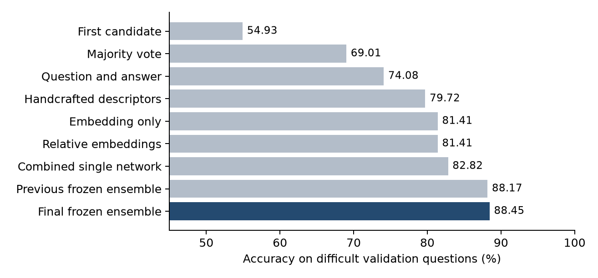
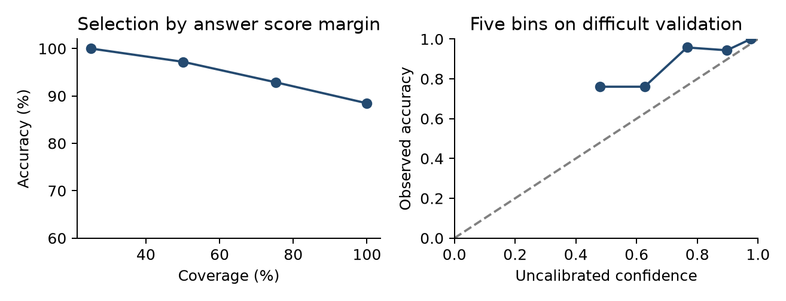

# MP2 Report — Selecting Reliable LLM Reasoning

DASE7506 Advanced Machine Learning Methods · Mini Project 2 · 27 October 2026

## Abstract

A compact ensemble selects a reference-correct numerical answer for 395 of 467 questions in the complete public test bank, giving 84.582% accuracy. Three candidate verifiers are combined with three seeds of a DeepSets comparison network and a numerical equality check. The full CPU prediction and scoring processes take 0.916 seconds locally, with 4.673 MiB of inference assets. This improves the previous frozen result by two questions; the subsequent 85% aspiration remains two correct questions away.

Agreement alone is insufficient: difficult-validation accuracy improves from 69.014% for majority voting to 88.451%. The latest extension improves validation by only one question, so evidence for its incremental benefit is limited. High answer-score margins identify an easier subset, but scores are not calibrated probabilities. Seven distinct frozen methods were tested during development; the final result is an adaptive benchmark result rather than an untouched holdout estimate.

## Task and research question

Each question supplies four generated solution texts and a 1024-dimensional representation for every candidate. The output is one candidate index. The unchanged official parser and scorer compare the selected final numeric answer with the reference; they do not grade every intermediate reasoning step [1, 2]. The model performs offline selection and never calls an LLM during evaluation.

The research question is whether comparing candidate evidence and checking numerical consistency improves selection beyond consensus, while remaining small and fast enough for the course limits. A related question is whether the resulting scores meaningfully identify uncertainty.

| Split | Questions | Difficult groups |
| --- | --- | --- |
| Training | 4,755 | 2,114 |
| Validation | 798 | 355 |
| Test | 467 | 467 by protocol |

A difficult group has at least two distinct valid parsed answers. Each supplied group has at least one reference-correct candidate. Easier groups explain much of the difference between complete-validation and difficult-validation accuracy.

## Method and implementation

### Candidate evidence

The supplied embedding is normalized to length 32. Candidate features concatenate this representation, its difference from the within-question mean, and handcrafted descriptors. The descriptors include valid-answer agreement, logarithmic trace length and answer magnitude, numerical overlap with the question, formatting counts, and generic lexical indicators. Each descriptor is accompanied by its deviation from the group mean. These are general functions of the provided inputs; question IDs are never features.

Two networks additionally receive the element-wise product of the candidate embedding and the group-mean embedding. This supplies a simple interaction with the surrounding candidates. All features use training means and scales, with a standard-deviation floor of 0.15 and standardized values clipped to [-10, 10]. The final networks have two hidden layers, with widths shown below, ReLU activations and training dropout.

| Member | Hidden widths | Objective | Seed | Frozen epoch |
| --- | --- | --- | --- | --- |
| ema42 | 128 and 32 | BCE with EMA | 42 | 46 |
| ema_context73 | 64 and 32 | BCE with EMA | 73 | 8 |
| context17 | 64 and 32 | List loss plus BCE | 17 | 132 |
| DeepSets x3 | 64 and 32 | BCE with EMA | 17, 42, 73 | 19 |

Training uses AdamW with learning rate 0.001 and dropout 0.4. Weight decay is 0.01 for BCE and 0.1 for list loss; EMA is 0.99 where used. Gradients use the 2,114 difficult training groups and exclude unparseable candidates. The original three models standardize using all training inputs; DeepSets uses difficult training inputs. Following set-based shared encoding and symmetric aggregation [5], its 64-dimensional encoder is compared with the valid-candidate mean, maximum and same-answer mean. Concatenating these with the candidate, its mean difference and product produces 384 features for the 32-to-1 head, preserving candidate permutation equivariance.

### Answer comparison and arithmetic evidence

Scores are divided by frozen within-question scales. The original ensemble supplies 90% of the neural score; the mean of three DeepSets seeds supplies 10%. Same-answer evidence then supplies half the candidate score. The revised arithmetic penalty is also averaged within each numeric answer group.

```text
s_i = 0.9 mean_old(f_i/T) + 0.1 mean_set(f_i/T)
g_i = 0.5 s_i + 0.5 mean_same(s_j) - 0.5 mean_same(b_j)
```

Here b counts numeric equalities with relative error above 0.001, using max(1, |left|, |right|) as denominator. The checker handles fractions, percentages and bounded powers, and avoids treating numeric tails of symbolic terms as full equations. Local-variable evidence was explored but has zero final weight. Unparseable answers are masked. Locally consistent arithmetic does not establish semantic correctness.

## Experimental protocol

Exploration compared answer-only features, handcrafted descriptors, supplied embeddings, relative embeddings, neural objectives, regularization, random seeds, boosted trees, sparse lexical models and kernel verifiers. Complete configurations and learning curves for 67 completed exploratory runs are retained. Validation selected base models and ensemble combinations, with difficult-validation accuracy as the primary criterion. Forward selection considered at most six members and a short answer-pooling grid.

GPU five-fold studies keep all four candidates together. The initial 24-family search selected common epochs using five-epoch-smoothed OOF curves; its refits did not exceed the original validation-selected ensemble. A further six DeepSets and six answer-balanced/SAM [6] configurations used nine-epoch smoothing over 100 epochs. Their best smoothed OOF scores were 82.103% and 82.093%. A fixed 17-setting validation blend grid selected the 10% DeepSets contribution. The train-OOF arithmetic proxy improved from 83.964% to 84.248% with the revised checker; this is not an OOF estimate of the final six-network ensemble.

| Evaluation | Method stage | Test correct | Test accuracy |
| --- | --- | --- | --- |
| 1 | Initial ensemble | 383 | 82.013% |
| 2 | Hard groups and averaging | 389 | 83.298% |
| 3 | Single CV family | 384 | 82.227% |
| 4 | Multiple CV families | 385 | 82.441% |
| 5 | OOF proxy and arithmetic | 387 | 82.869% |
| 6 | Original frozen ensemble | 393 | 84.154% |
| 7 | DeepSets blend and revised checker | 395 | 84.582% |

## Ablations and comparative results

| Method | Complete validation | Difficult validation |
| --- | --- | --- |
| First candidate | 78.195% | 54.930% |
| Majority vote | 86.216% | 69.014% |
| Question and answer | 88.471% | 74.085% |
| Handcrafted descriptors | 90.977% | 79.718% |
| Embedding only | 91.729% | 81.408% |
| Relative embeddings | 91.729% | 81.408% |
| Combined single network | 92.356% | 82.817% |
| Previous frozen ensemble | 94.737% | 88.169% |
| Final frozen ensemble | 94.862% | 88.451% |



Figure 1  Difficult-validation comparisons.

Answer agreement provides a substantial baseline. Handcrafted descriptors and embeddings each add predictive information, while the combined model is stronger than either single information source in these runs. This supports using complementary evidence, but it does not establish that the model has learned a faithful mathematical proof checker: formatting, answer statistics and generator-specific patterns remain available shortcuts.

On the same six frozen networks, removing the arithmetic penalty gives 87.606% difficult-validation accuracy; adding it gives 88.451%, a gain of three validation questions. The answer-balanced/SAM family was rejected: its standalone difficult-validation accuracy was 85.634%, and its tested blends did not exceed the selected method. Adding complexity alone was insufficient.

## Uncertainty and selective accuracy



Figure 2  Validation reliability diagnostics. Left: retaining questions with larger distinct-answer margins. Right: uncalibrated softmax confidence over distinct answers.

| Coverage on difficult validation | Retained questions | Accuracy |
| --- | --- | --- |
| 25.1% | 89 | 100.000% |
| 50.1% | 178 | 97.191% |
| 75.2% | 267 | 92.884% |
| 100.0% | 355 | 88.451% |

The margin is the difference between the best and second-best distinct-answer score. It ranks uncertainty more usefully than treating every selected answer as equally reliable: the highest-margin quarter contains 89 questions and is entirely reference-correct in this validation sample. This is an exploratory observation on the development split; it does not guarantee 100% precision on unseen questions.

The reliability plot uses five equal-count bins and an uncalibrated softmax over distinct-answer scores. Its expected calibration error is 13.53 percentage points. Score scales were normalized for fusion, not fitted as probabilities. These values therefore should not be interpreted as calibrated likelihoods of correctness. A new calibration split or nested calibration procedure would be required before deploying a confidence threshold.

Compared with majority voting, the final method fixes 82 difficult-validation questions while regressing on 13. The net gain is substantial, but individual high-margin errors remain. Correlated candidate traces can agree on the same omitted condition, and a confident learned score can reinforce that shared mistake.

## Failure analysis and limits of correctness labels

### An omitted quantity despite correct arithmetic

In a validation question, a class has 250 students, all 140 girls attend, and attending girls are twice as numerous as attending boys. The reference answer is 40 absent boys: 250 - 140 - 70. Three candidates instead return 180 by subtracting only 70 attending boys from the total. The selected wrong trace contains locally correct calculations. The numerical checker cannot detect the missing group of 140 girls; the failure is about representing the question conditions.

### A plausible reading can disagree with the reference

Another question says Yun starts with 20 paperclips and loses 12, while Marion has "1/4 more than" Yun now has, plus 7. The supplied reference is 9, following (20 - 12)/4 + 7. The model selects 17, following 8 + 8/4 + 7, which is a natural reading of "one quarter more than". The official scorer correctly marks it wrong under its reference, but the example cautions against equating every reference mismatch with demonstrably invalid reasoning. No reference or scorer was changed.

### Reversing a relation between entities

In a pens-and-pencils question with 108 utensils, the reference relation gives 16 pens, while the selected candidate reverses which entity equals five times the other plus 12 and returns 92. Both alternatives contain consistent algebra once the relation is chosen. Distinguishing them requires grounding the equation in the wording, beyond checking arithmetic or consensus.

### What the method can and cannot establish

The method is an empirical verifier of final answers within the supplied candidate distribution. It checks only a subset of explicit calculations and cannot prove completeness of a solution, validate arbitrary symbolic algebra, or guarantee the intended interpretation of ambiguous language. Conversely, a correct final answer may contain incorrect intermediate steps.

The strongest limitations are adaptive public-test feedback, a relatively small difficult-validation split, generator-specific features, and correlated mistakes across candidates. Increasing network capacity, adding many arithmetic-relation features, or learning a nonlinear score fusion did not reliably improve the train OOF results.

## Resources and reproducibility

| Resource | Measured value or configuration |
| --- | --- |
| Frozen asset files | 4,899,529 bytes  4.673 MiB |
| Fresh prediction process | 0.859 seconds |
| Independent scoring process | 0.057 seconds |
| Total complete-bank CPU evaluation | 0.916 seconds |
| Evaluation hardware | Ryzen 7 9700X  four library threads |
| Training search GPU | RTX 5060 Ti 16 GB  PyTorch 2.9.0 CUDA 13.0 |
| Frozen training reproduction | Original CPU 24.987 s  new GPU seeds 5.061 s |

```text
python -m pip install -r code/requirements-inference.txt
python code/evaluate.py --split test \
  --checkpoint code/checkpoints/candidate85 \
  --output-dir runs/reproduction85
```

Use Python 3.12 and NumPy 2.3.5. For training, code/reproduce_training.py rebuilds the original CPU models; code/reproduce_optimization85.py refits the new CUDA seeds at fixed epoch 19. Both reproduced all learned arrays exactly locally. 

## AI disclosure

OpenAI Codex provided substantive assistance in training code, running experiments, and drafting report. The reported numerical scores come from execution of the unchanged independent course scorer. No score was fabricated or manually inserted into the prediction output. No LLM generation or API call occurs during evaluation. No external training dataset, additional pretrained weights, question-ID feature or answer lookup is used. Evaluation prediction files are retained as evidence and are not read by inference.

## References

[1] Zaheer et al. Deep Sets. NeurIPS 2017. https://arxiv.org/abs/1703.06114

[2] Foret et al. Sharpness-Aware Minimization for Efficiently Improving Generalization. ICLR 2021. https://arxiv.org/abs/2010.01412
